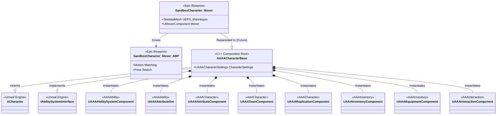
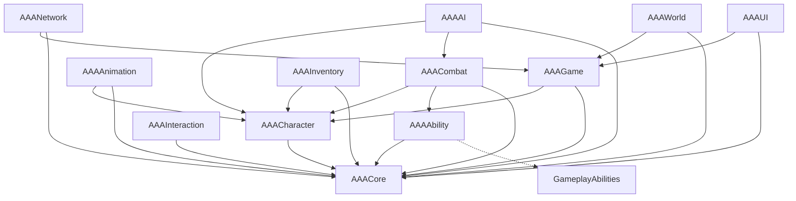
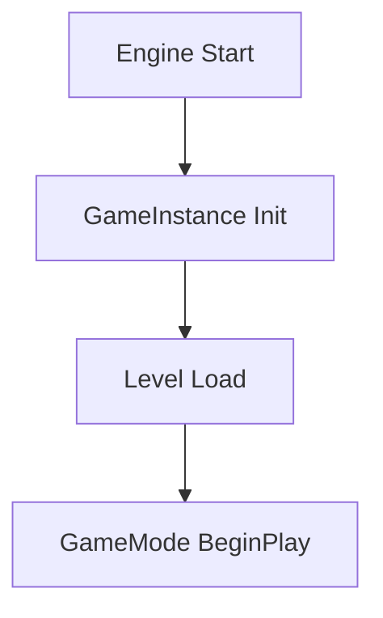
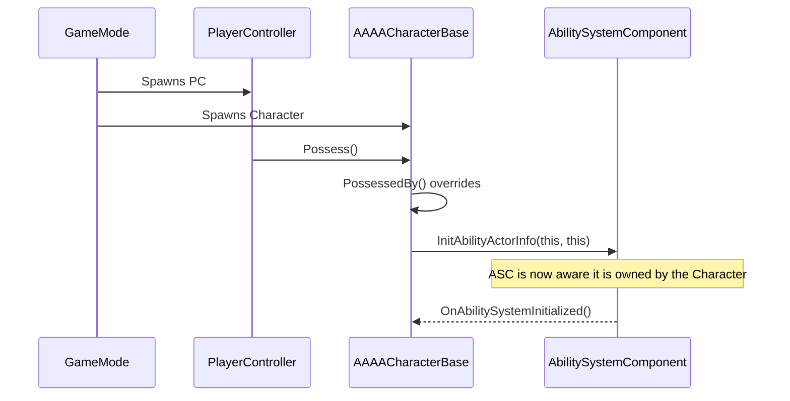
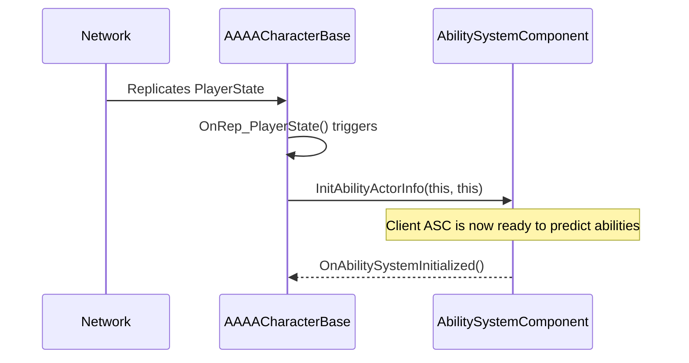

# ARCHIVE_Gameplay_Architecture

> [!CAUTION]
> ## SUPERSEDED HISTORICAL ARCHIVE — DO NOT IMPLEMENT AGAINST THIS DOCUMENT
> This file contains historical design documentation from earlier development sessions. 
> The class hierarchies (e.g. `AAAACharacterBase` inheriting `ACharacter`) and component ownership models described herein have been **SUPERSEDED** by the canonical Lyra-style composition root (`AAAAAPlayerPawn` inheriting `APawn`, ASC owned by `AAAAAPlayerState`).
> Refer strictly to [PROJECT_OVERVIEW.md](file:///a:/UNREAL%20PROJECT/Game/GameAnimationSample/Docs/PROJECT_OVERVIEW.md) and [ROADMAP.md](file:///a:/UNREAL%20PROJECT/Game/GameAnimationSample/Docs/ROADMAP.md) for current canonical architecture and standards.

*This file is a merged archive of older, granular documentation.* 


---
## FROM ORIGINAL FILE: ARCHITECTURE.md
---

# AAA Multiplayer RPG — Architecture Guidelines

## The Core Principle
This project is built directly on top of Epic's **Game Animation Sample (GAS)**. 
We treat Epic's locomotion systems as Engine Code. We do not rewrite, duplicate, or destroy them. We only **Extend, Wrap, or Compose**.

## System Boundaries

### What Epic Owns (Locomotion & Animation)
- **Motion Matching & Pose Search:** Evaluates databases to dynamically pick the best animation frame.
- **Choosers:** Data-driven logic to select which database to evaluate based on context (e.g., speed, gait).
- **Trajectory Component:** Predicts the character's future path.
- **Motion Warping:** Warps root motion for exact alignment (Vaulting).
- **Control Rig & Animation Warping:** Handles IK, Stride Warping, and Orientation Warping.
- **Epic's Assets:** `BP_SandboxCharacter`, `ABP_SandboxCharacter`.

### What We Own (Gameplay)
- **Custom Modules:** `AAACore`, `AAAGame`, `AAACharacter`.
- **Gameplay Ability System (GAS):** Abilities, attributes, and effects.
- **Combat & Mounts:** Attack logic, combos, and dragon riding mechanics.
- **Inventory & Quests:** Data persistence and world interaction.
- **Multiplayer:** Dedicated server logic, replication, and networking.

## Inheritance & Composition Strategy

### Character Hierarchy
1. `ACharacter` (Engine Base)
2. `AAAACharacterBase` (Our C++ Class. Holds GAS, Inventory, Custom Modules)
3. `BP_SandboxCharacter` (Epic's Blueprint. Reparented to `AAAACharacterBase`. Holds Epic's Trajectory, Mover, Input)
4. `BP_AAAPlayerCharacter` (Our Blueprint Child of SandboxCharacter. Holds specific meshes and overrides).

### Animation Hierarchy
1. `UAnimInstance` (Engine Base)
2. `ABP_SandboxCharacter` (Epic's Locomotion Graph)
3. `ABP_AAAPlayerCharacter` (Our Child AnimBP. Used for overriding specific animations or injecting Linked Anim Layers).

## Component-Driven Design
Whenever possible, new functionality should be added via **Actor Components** (e.g., `UAAALockOnComponent`, `UAAAInventoryComponent`) rather than bloating the character class. Communication between components and actors should rely on **Interfaces** rather than hard casts.

## Content Architecture & Ownership
- **Epic Games Foundation**: Root-level folders (e.g., `Blueprints`, `Characters`, `Locomotor`, `Input`) belong to Epic. Do not modify or move these assets.
- **AAA Domain**: All custom development lives strictly inside `Content/AAA/` (e.g., `AAA/Animation`, `AAA/Blueprints`, `AAA/Weapons`).

## Input Mapping Audit
The project relies on Unreal Engine's Enhanced Input system.
- **Primary Mapping Context**: `IMC_Sandbox`
- **Core Input Actions**:
  - `IA_Move`, `IA_Look`, `IA_Jump`, `IA_Crouch`, `IA_Sprint`, `IA_Walk`, `IA_Strafe`
  - `IA_Aim`, `IA_Traverse`, `IA_Interact`, `IA_TeleportToTarget`
  - `IA_TwinStick_AimDirection`, `IA_Look_Gamepad`
- **Controller Support**: Setup supports Keyboard/Mouse, Gamepad, and Mobile (`TIS_MobileControls`).
- **Future Integration**: Custom Input Mapping Contexts (e.g., `IMC_Combat`) will be added to the `AAA/Input/` directory and overlaid dynamically on top of `IMC_Sandbox` via our custom Player Controller.

- [x] Phase 6.5: Core Gameplay Framework (Native Engine Layer) Complete.


---
## FROM ORIGINAL FILE: DATA_DRIVEN_ARCHITECTURE.md
---

# Data-Driven Gameplay Architecture

The entire AAA Gameplay Framework is built on a data-driven paradigm. This means **no gameplay values are hardcoded in C++**.

## The Core Concept
Instead of placing `BaseHealth = 100.0f` inside the `AAAAPlayerPawn.cpp` constructor, we extract this data into **Primary Data Assets**.

## Benefits
1. **Designer Autonomy**: Designers can tweak weapon damage, dragon flight speed, and NPC loot tables entirely within the Unreal Editor without needing a C++ programmer.
2. **Memory Efficiency**: Primary Data Assets are loaded asynchronously via Soft Object Pointers. If the player isn't riding a Dragon, the Dragon's massive animation sets and behavior trees are never loaded into RAM.
3. **Multiplayer Safety**: The server dictates the data. By feeding `UAAACharacterSettings` directly into the Ability System Component during initialization, the server guarantees the correct starting abilities and tags are replicated to the client perfectly.

## The Modules
The data assets are split across modules to prevent circular dependencies:
- `AAACharacter`: Houses `AAACharacterSettings` (Vitals, Movement, Base Input).
- `AAACombat`: Houses `AAAWeaponSettings` (Damage, Animations, Combos).
- `AAAAbility`: Houses `AAAAbilitySettings` (UI Metadata, GAS Costs/Cooldowns).
- `AAAAI`: Houses `AAANPCSettings` and `AAADragonSettings` (Behavior Trees, Faction Tags, Flight).
- `AAACore`: Houses `AAAFactionSettings` (Reputation, Enemy Lists).

## The Data Library
To safely load these assets, the `AAAGame` module provides a global `UAAADataLibrary` Blueprint Function Library. Blueprints can use this library to cast and load Data Assets safely.


---
## FROM ORIGINAL FILE: GAS_ARCHITECTURE.md
---

# Gameplay Ability System (GAS) Architecture

This document describes how GAS is integrated into the AAA Framework.

## Core Components
- `UAAAAbilitySystemComponent`: The brains of the operation. Holds tags, active effects, and granted abilities.
- `UAAAAttributeSet`: Holds the raw, replicated float values for stats.
- `FAAAGameplayTags`: The native C++ singleton that globally registers and caches Gameplay Tags, making C++ tag comparisons blazingly fast.

## Best Practices
- **No Direct Attribute Modification:** Never modify `AttributeSet->Health` directly. All modifications MUST occur via `UGameplayEffect`. This ensures calculation modifiers, immunity tags, and prediction are applied correctly.
- **Native Tags over Blueprints:** Always use `FAAAGameplayTags::Get().MyTag` in C++ instead of relying on `FGameplayTag::RequestGameplayTag(FName(...))`.


---
## FROM ORIGINAL FILE: FRAMEWORK_DIAGRAM.md
---

# Framework Composition Diagram
**Phase 4.1** | AAA Multiplayer RPG

This diagram illustrates the full structural composition of the playable character. It demonstrates how our custom C++ foundation sits between the raw Unreal Engine architecture and Epic's experimental Blueprint assets, allowing us to build gameplay features without altering their locomotion logic.

---

## Complete Character Composition



## Architectural Notes
- **Composition over Inheritance:** `AAAACharacterBase` contains almost no actual C++ logic. All gameplay features (like finding items or changing health) are delegated to the respective components.
- **Data Driven:** The `CharacterSettings` Data Asset injected into `AAAACharacterBase` prevents any hardcoded variables (like Max Walk Speed or Jump Height) from being compiled into the C++.
- **Total Decoupling:** Epic's `SandboxCharacter_Mover_ABP` remains entirely ignorant of our C++ framework, evaluating only the trajectory and tags provided by the `UMoverComponent`.


---
## FROM ORIGINAL FILE: DEPENDENCY_GRAPH.md
---

# Module Dependency Graph
**Phase 3.5** | AAA Multiplayer RPG

This document maps out the internal module dependency hierarchy for the custom AAA framework, ensuring no circular dependencies exist and that module responsibilities remain strictly segregated.

## High-Level Architecture

The framework relies on a **hub-and-spoke** model, where `AAACore` acts as the foundational root module that all other modules depend on, either directly or indirectly. No higher-level gameplay module ever forces a dependency back onto `AAACore`.



## Detailed Dependency Matrix

| Module | Depends On (Private/Public) | Notes |
| :--- | :--- | :--- |
| **AAACore** | `Core`, `CoreUObject`, `Engine`, `InputCore` | Foundation module. Contains global tags and interfaces. |
| **AAACharacter** | `AAACore` | Relies only on Core to prevent bloating character definitions. |
| **AAAGame** | `AAACore`, `AAACharacter` | Game modes and states orchestrating characters. |
| **AAAAbility** | `AAACore`, `GameplayAbilities`, `GameplayTags`, `GameplayTasks` | Encapsulates GAS. Verified plugin is enabled. |
| **AAACombat** | `AAACore`, `AAACharacter`, `AAAAbility` | Connects weapons, characters, and ability executions. |
| **AAAAnimation** | `AAACore`, `AAACharacter` | Controls runtime locomotion graphs. |
| **AAAInventory** | `AAACore`, `AAACharacter` | Equipment and item handling for the character. |
| **AAAInteraction** | `AAACore` | Generic interaction logic independent of specific actors. |
| **AAAAI** | `AAACore`, `AAACharacter`, `AAACombat` | AI controllers require character and combat access. |
| **AAANetwork** | `AAACore`, `AAAGame` | Server replication and net-code orchestration. |
| **AAAWorld** | `AAACore`, `AAAGame` | World state and environmental interactions. |
| **AAAUI** | `AAACore`, `AAAGame` | UI logic bound to game state. |

## Verification Results
- **Circular Dependencies:** 0 detected.
- **Root Enforcement:** `AAACore` correctly isolates interfaces without referencing upper-level implementation modules.


---
## FROM ORIGINAL FILE: INITIALIZATION_ORDER.md
---

# Initialization Order
**Phase 4.1** | AAA Multiplayer RPG

This document maps out the specific order in which classes and components initialize in our custom AAA Framework, particularly emphasizing the client-server handshake required for the Gameplay Ability System.

---

## Global Startup Pipeline



## Actor & Component Initialization Pipeline

Once the GameMode spawns the player:

1. **PlayerController Creation**
   - GameMode spawns `PC_Sandbox`.
   - Controller awaits a Pawn to possess.

2. **Character Creation (`AAAACharacterBase`)**
   - The constructor `AAAACharacterBase()` is called.
   - All 6 Custom Subobjects are created:
     - `UAAAAbilitySystemComponent`
     - `UAAAAttributeSet`
     - `UAAAAttributeComponent`
     - `UAAATeamComponent`
     - `UAAAReplicationComponent`
     - `UAAAInventoryComponent`
     - `UAAAEquipmentComponent`
     - `UAAAInteractionComponent`
   - Memory is allocated, but pointers to `GetOwner()` may not be fully resolved for gameplay yet.

3. **BeginPlay**
   - `AAAACharacterBase::BeginPlay()` fires.
   - Components run their respective `BeginPlay()` overrides.

## The Gameplay Ability System (GAS) Handshake

Because GAS is inherently a multiplayer framework, it must be initialized at different times on the Server versus the Client.

### Server Initialization Flow


### Client Initialization Flow


## Future Considerations
If the project shifts to using `PlayerState` as the owner of the `AbilitySystemComponent` (to persist attributes across character respawns), the initialization signature will change from `InitAbilityActorInfo(this, this)` to `InitAbilityActorInfo(PlayerState, this)`. For now, `AAAACharacterBase` owns its own ASC.


---
## FROM ORIGINAL FILE: AI_AUTOMATION_PIPELINE.md
---

# AI Automation Pipeline (Python Remote Execution)

> **Status:** CONFIRMED WORKING (Tested 2026-08-21)
> **Connection:** `http://127.0.0.1:30010` — Remote Control API is live
> **Engine:** Unreal Engine 5.8
> **Plugins Required:** Remote Control API, Python Editor Script Plugin (both enabled)

> [!WARNING]
> ### CRITICAL SECURITY REQUIREMENT: Editor & Development Builds ONLY
> The Remote Control API and Python Editor Script Plugin expose unauthenticated HTTP/JSON endpoints that can execute arbitrary Python commands and mutate UObjects.
> - These plugins must be strictly gated to Editor/Development targets (`"TargetAllowList": ["Editor"]` in `.uproject` or `.uplugin`).
> - **NEVER** package or compile these plugins into `Shipping` or `Test` targets. An open HTTP endpoint on a packaged client or dedicated server represents a Remote Code Execution (RCE) vulnerability.

---

## Overview

Antigravity (AI) can directly interact with the running Unreal Engine Editor in real-time.
The AI writes Python scripts locally, executes them via PowerShell, and those scripts talk to the
Unreal Editor through its built-in Remote Control HTTP API on `localhost:30010`.

This creates a closed loop: **AI writes script → runs it → reads output → fixes/iterates → runs again**.
The developer does NOT need to copy-paste instructions or manually click through the editor for most tasks.

---

## Confirmed Capabilities (What AI CAN Do)

### 1. Asset Creation & Management
- Create Data Assets (e.g., new `UAAAItemData` instances for weapons, potions, armor)
- Import meshes, textures, and audio files into the Content Browser
- Rename, move, and organize assets in bulk
- Delete or duplicate assets programmatically
- Query the Content Browser for existing assets by path or class

### 2. Level Design & Actor Manipulation
- Spawn actors into the current level (e.g., place 50 trees, walls, or NPCs)
- Move, rotate, and scale actors by setting transforms
- Attach components to existing actors
- Query all actors currently in the level and read their properties
- Select actors programmatically

### 3. Data Asset Configuration
- Set default property values on Blueprint assets and Data Assets
- Assign animation sequences, meshes, materials to specific properties
- Link assets together (e.g., "assign this sword mesh to this weapon Data Asset")
- Configure arrays and maps inside Data Assets

### 4. Animation Pipeline
- Assign animation sequences to animation slots or montages
- Set up animation notify events on existing montages
- Configure blend spaces and set parameters
- Associate specific animations with rigs/skeletons for specific conditions

### 5. Material & Visual Setup
- Create Material Instances and set parameter values (colors, textures, scalars)
- Apply materials to meshes in the level
- Batch-configure material properties across many assets

### 6. Testing & Validation
- Start/stop Play-In-Editor (PIE) sessions
- Query the editor log for errors and warnings
- Validate asset references and check for broken links

### 7. Autonomous Iteration Loop
The AI's core workflow is:
1. Write a Python script based on the developer's request
2. Execute it locally via PowerShell
3. Read the JSON response or error output from Unreal
4. If errors: fix the script and retry automatically
5. If success: confirm with the developer

---

## Limitations (What AI CANNOT Do Well)

### Blueprint Node Graphs
The Unreal Python API does NOT provide reliable tools to:
- Create visual Blueprint node graphs (adding/connecting pins and wires)
- Lay out nodes visually inside the Blueprint editor
- Create custom Blueprint functions or macros via scripting

**Solution:** All complex game logic (combat, inventory, abilities, interactions) is written
in **C++** by the AI. The developer only needs to connect the final 1-2 execution pins in
Blueprint if needed. The AI pre-loads and configures everything else.

### What the Developer Still Does Manually
- Wire the final few Blueprint nodes together (if any logic is in BP at all)
- Visual polish that requires eyeballing (exact camera angles, lighting tweaks)
- Compile C++ code in Visual Studio (AI writes it, developer hits Build)

---

## Setup (Already Complete)

1. [x] Open Unreal Engine Editor
2. [x] Edit > Plugins > Enable **Python Editor Script Plugin**
3. [x] Edit > Plugins > Enable **Remote Control API**
4. [x] Restart Editor
5. [x] Connection verified via `test_ue_remote.py` on `localhost:30010`

---

## Workflow Examples

### Example 1: Create Item Data Assets
```
Developer: "Create 5 new potion Data Assets based on UAAAItemData with names: HealthPotion, ManaPotion, StaminaPotion, AntidotePotion, FireResistPotion"

AI: Writes Python script using unreal.AssetToolsHelpers
AI: Executes script → 5 Data Assets appear in Content/AAA/Items/Consumables/
AI: Reads success response, confirms to developer
```

### Example 2: Place Props in Level
```
Developer: "Scatter 30 barrel actors randomly in the courtyard area around coordinates (1000, 2000, 0)"

AI: Writes Python script that spawns StaticMeshActors with random offsets
AI: Executes → 30 barrels appear in the viewport instantly
AI: Reads result, confirms placement
```

### Example 3: Assign Animation to Rig
```
Developer: "I have a sword_attack_01 animation in Content/AAA/Animations/Combat/. Assign it to the attack montage slot on the player character."

AI: Writes Python script to find the AnimMontage asset, set the animation sequence reference
AI: Executes → Animation is linked in the Data Asset
Developer: Can preview it immediately in Unreal
```

### Example 4: Autonomous Error Recovery
```
AI: Runs a script to create a material instance
Unreal: Returns error — parent material path is wrong
AI: Reads the error, queries Content Browser for the correct path
AI: Fixes the script automatically and re-runs
Unreal: Material instance created successfully
AI: Confirms to developer — no manual intervention needed
```

---

## Technical Details

### Connection Endpoint
- **URL:** `http://127.0.0.1:30010`
- **Protocol:** HTTP REST (JSON payloads)
- **Key Endpoints:**
  - `GET /remote/info` — Server info and status
  - `PUT /remote/object/call` — Call a function on a UObject
  - `PUT /remote/object/property` — Get/set a property on a UObject
  - `PUT /remote/batch` — Execute multiple commands atomically

### Python Execution
Scripts are executed locally on the developer's machine via PowerShell:
```powershell
python script_name.py
```
The scripts use Python's `urllib` or `requests` to communicate with the Unreal Remote Control API.
No additional dependencies required beyond standard Python 3.10+.

### Test Script Location
- [test_ue_remote.py](file:///a:/UNREAL%20PROJECT/Game/GameAnimationSample/test_ue_remote.py) — Connection verification script

---

## For Other Antigravity Instances

> [!IMPORTANT]
> If you are a new Antigravity instance working on this project, this is your bridge to the
> Unreal Editor. You can run Python scripts that hit `localhost:30010` to automate editor tasks.
> The connection is confirmed working. Read __PIPELINE__.md for the full project context,
> and PROJECT.md for the current session state.


---
## FROM ORIGINAL FILE: AI_MEMORY.md
---

# AI Memory

This document stores persistent context and architectural rules to ensure consistency across sessions.

## Project Rules
1. **The Game Repository:** The ONLY source of truth is `Game/GameAnimationSample`.
2. **The Old Repository:** The `AAATitle` repository is abandoned and strictly for historical reference.
3. **Epic's Assets:** We do NOT modify Epic's Game Animation Sample Blueprints or databases directly. We only Extend, Wrap, or Compose.
4. **Locomotion:** Driven entirely by Epic's Motion Matching and Pose Search framework.
5. **Gameplay:** Driven entirely by our C++ `AAA` modules and the Gameplay Ability System.

## Architecture Guidelines
- Epic's `BP_SandboxCharacter` is reparented to our C++ `AAAACharacterBase`.
- `AAAACharacterBase` holds all RPG logic (Inventory, Health, Attributes, GAS).
- Epic's AnimGraph (`ABP_SandboxCharacter`) is inherited via a Child AnimBP or Linked Anim Layers to inject custom combat animations.

## Content Ownership & Organization
- **Epic Territory**: Root-level folders outside of `AAA/` (like `Blueprints`, `Characters`, `Input`) must remain strictly untouched.
- **AAA Territory**: ALL new custom content MUST go into the `Content/AAA/` directory framework.
- **Naming Conventions**: Enforced prefixes must be used (e.g., `L_` for Levels, `BP_` for Actors, `WBP_` for Widgets, `DA_` for Data Assets, `IA_` for Input Actions). See `CONTENT_STRUCTURE.md` for the complete list.

- [x] Phase 6.5: Core Gameplay Framework (Native Engine Layer) Complete.


---
## FROM ORIGINAL FILE: CHARACTER_FRAMEWORK.md
---

# Character Framework Specification
**Phase 4.1** | AAA Multiplayer RPG

This document outlines the architectural rules and C++ implementations of the core character framework.

---

## 1. The Composition Root: `AAAACharacterBase`
Our C++ Character (`AAAACharacterBase`) inherits from Unreal's native `ACharacter`. Its sole responsibility is to instantiate and own the framework components. 

**Rules:**
- `AAAACharacterBase` must **never** contain gameplay logic (e.g., `void TakeDamage(float Amount)`).
- It must implement `IAbilitySystemInterface` so that external actors can retrieve its ASC.
- It exposes a `UAAACharacterSettings` Data Asset for configuration.

## 2. Component Directory

### `UAAAAbilitySystemComponent` (`AAAAbility` Module)
Overrides initialization logic to ensure tags and startup abilities are handled natively before Blueprint execution. 
**Rule:** Abilities are granted via this component, never stored in arrays on the character itself.

### `UAAAAttributeSet` (`AAAAbility` Module)
The centralized container for numeric stats (Health, MaxHealth, Stamina, Mana).
**Rule:** Variables like `Health` must never exist on `AAAACharacterBase`. They only exist here.

### `UAAAAttributeComponent` (`AAACharacter` Module)
Replaces the legacy `HealthComponent`. Provides a cleaner API for Blueprints and UI to query the ASC for stats and subscribe to change delegates without needing to understand the complex GAS API.

### `UAAATeamComponent` (`AAACharacter` Module)
Implements `IAAATeamAgent`. Determines Faction alignment, hostile/friendly status for AI perception, and PVP flags.

### `UAAAReplicationComponent` (`AAACharacter` Module)
A utility component for handling custom state rollbacks, syncs, or RPCs that fall outside the scope of Epic's Mover plugin.

### `UAAAInventoryComponent` (`AAAInventory` Module)
A networked container for items. 
**Rule:** Must not assume the owner is a Character; chests or vehicles could also have an inventory.

### `UAAAEquipmentComponent` (`AAAInventory` Module)
Handles the attachment of skeletal meshes or static meshes to specific character sockets (e.g., Weapons, Helmets) based on the current active item.

### `UAAAInteractionComponent` (`AAAInteraction` Module)
Executes line traces or sphere overlaps to locate actors implementing the `IAAAInteractable` interface.

## 3. Data-Driven Approach
The `UAAACharacterSettings` Primary Data Asset prevents designers from needing to edit the base Blueprint for raw values. It contains nested structs for:
- `FAAACharacterMovementSettings` (Speeds, Acceleration)
- `FAAACharacterCameraSettings` (FOV, Spring Arm offsets)
- `FAAACharacterInputSettings` (Look sensitivities)
- `FAAACharacterAnimationSettings` (Locomotion style enum fallbacks)

## 4. Blueprint Reparenting
We do not touch the Epic `SandboxCharacter_Mover` or its Animation Blueprints. Once our C++ framework is proven stable in testing phases, we perform a native UE Editor reparent of `SandboxCharacter_Mover` to `AAAACharacterBase`. The blueprint nodes will seamlessly inherit the GAS and component foundations.


---
## FROM ORIGINAL FILE: GAMEPLAY_FOUNDATION.md
---

# Gameplay Foundation Architecture

This document describes the core C++ framework that supports gameplay systems across the project.

## Initialization Flow
1. `AAAAAPlayerPawn` spawns.
2. In `PossessedBy()` (Server) and `OnRep_PlayerState()` (Client), the `UAAAAbilitySystemComponent` is initialized.
3. The Pawn calls `AttributeComponent->InitializeWithAbilitySystem()` to bind UI and gameplay delegates securely.
4. The ASC grants `StartupAbilities` and `StartupEffects`.

## Death & Respawn Lifecycle
When `Health` reaches 0:
1. `UAAAAttributeComponent` detects the value via an ASC delegate.
2. The component broadcasts `OnDeath()`.
3. `AAAAPlayerPawn` catches `OnDeath()` and safely disables player input and stops ticks, gracefully halting Epic's Mover component without breaking it.

## Extension
Never use Blueprint to manually set variables like Health. Always use the provided wrapper functions (e.g., `TakeDamage()`) or apply Gameplay Effects natively.


---
## FROM ORIGINAL FILE: GAMEPLAY_FRAMEWORK.md
---

# AAA Native Gameplay Framework

This document outlines the core C++ framework classes built inside the `AAAGame` module. These classes form the permanent backbone of the game, completely replacing Epic's default classes while strictly preserving their locomotion and animation systems (Mover, Motion Matching).

---

## 1. UAAAAGameInstance (`AAAAGameInstance.h`)
- **Inherits**: `UGameInstance`
- **Lifetime**: Created when the application starts, destroyed when the application closes. Survives map travels.
- **Networking**: Local only (exists on clients and the dedicated server, but does not replicate between them).
- **Responsibilities**:
  - Save and Load Systems
  - Session Management (Epic Online Services, Steam)
  - Persistent Audio and Graphics Settings
  - Global map travel state and matchmaking.

---

## 2. AAAAAGameModeBase (`AAAAGameModeBase.h`)
- **Inherits**: `AGameModeBase`
- **Lifetime**: Created when the level loads, destroyed when the level unloads.
- **Networking**: **Server-only**. Clients never instantiate or see the GameMode.
- **Responsibilities**:
  - Match Flow (Lobby, Countdown, In-Progress, Post-Match).
  - Player spawning, respawning, and difficulty initialization.
  - Dictates which Default Pawn, Player Controller, and HUD to spawn.

---

## 3. AAAAAGameState (`AAAAGameState.h`)
- **Inherits**: `AGameStateBase`
- **Lifetime**: Tied to the GameMode (level duration).
- **Networking**: **Replicated** from Server to all Clients.
- **Responsibilities**:
  - Global World State (Current Act, Day/Night cycle, Weather).
  - Managing active World Events (World Bosses, Faction Wars).
  - Scoreboards and Team management.

---

## 4. AAAAAPlayerState (`AAAAPlayerState.h`)
- **Inherits**: `APlayerState`
- **Lifetime**: Survives Pawn death. Lives as long as the player is connected to the session.
- **Networking**: **Replicated** from Server to all Clients.
- **Responsibilities**:
  - Persistent Player Data: Level, Experience, Gold.
  - Reputation scores and Faction standing.
  - Playtime and Achievement progress.
  - *Note: Health and Stamina are excluded, as they belong on the Ability System Component (GAS).*

---

## 5. AAAAAPlayerController (`AAAAPlayerController.h`)
- **Inherits**: `APlayerController`
- **Lifetime**: Lives as long as the player is connected.
- **Networking**: Client-owned. Replicated between Server and the owning Client (but hidden from other clients).
- **Responsibilities**:
  - Enhanced Input mapping and routing.
  - Camera ownership (cutscenes, dialogue camera transitions).
  - Handling UI interaction (Pause menu, Inventory toggles).
  - Target lock-on logic.

---

## 6. AAAAAHUD (`AAAAHUD.h`)
- **Inherits**: `AHUD`
- **Lifetime**: Tied to the level.
- **Networking**: **Client-only**. The server does not use HUDs.
- **Responsibilities**:
  - Purely for spawning, maintaining, and hiding User Widgets (UI).
  - Spawns the Compass, Minimap, Health Bars, and floating damage numbers.
  - *No gameplay logic belongs here.*

---

## Architecture Integration
To cleanly integrate this C++ framework with Blueprints:
1. `AAAAGameModeBase` utilizes `ConstructorHelpers::FClassFinder` in C++ to automatically seek out Blueprints located in `Content/AAA/Blueprints/GameFramework/`.
2. When the project launches, the C++ code automatically injects the BP versions (e.g., `BP_AAAPlayerController`), which in turn automatically possess `BP_PlayerCharacter`.

This strict separation ensures the C++ codebase handles all networking and state logic while the Blueprint layer is purely used for asset configuration.


---
## FROM ORIGINAL FILE: ATTRIBUTE_SYSTEM.md
---

# Attribute System

## Overview
The `UAAAAttributeSet` contains the core vital and progression stats for all characters in the game. It is fully multiplayer replicated and tightly secured.

## Available Attributes
- **Vital:** `Health`, `MaxHealth`, `Stamina`, `MaxStamina`
- **Movement:** `MovementSpeed`
- **Progression:** `Experience`, `Level`

## Safeties & Clamping
Attributes are inherently clamped at the native C++ level.
- `PreAttributeChange`: Intercepts raw modifications before they are applied, ensuring `Health` never drops below `0` or exceeds `MaxHealth`.
- `PostGameplayEffectExecute`: Re-evaluates bounds after complex mathematical operations occur from abilities or buffs.


---
## FROM ORIGINAL FILE: HEALTH_SYSTEM.md
---

# Health Component System

## Overview
The `UAAAAttributeComponent` is a lightweight proxy that sits on the Character and exposes complex Gameplay Ability System math to simple Blueprints and UI widgets.

## Usage
Instead of writing complex GAS logic, designers can simply call:
- `TakeDamage(10.0f)`
- `Heal(25.0f)`
- `Kill()`
- `Revive()`

Under the hood, these C++ functions apply pre-authored `GE_DirectDamage` / `GE_DirectHeal` classes via `SetByCallerMagnitude` using `Data.Damage` and `Data.Healing` tags and submit them to the ASC (strictly adhering to the zero-dynamic-allocation combat rule and ensuring calculation rules like `Status.Invincible` are respected).

## Delegates
UI Widgets can bind to these dynamic multicast delegates:
- `OnHealthChanged`: Broadcasts Current, Max, and Delta health values.
- `OnDeath`: Fired when Health reaches 0.
- `OnRevived`: Fired when a character is brought back to life.
